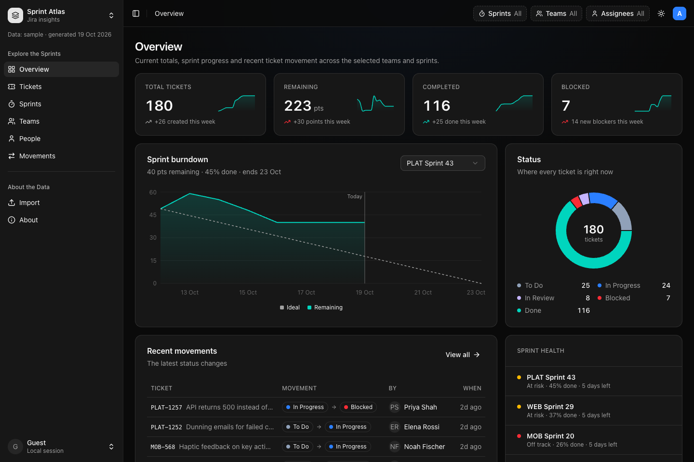

# Jira Dashboard

A proof-of-concept dashboard for Jira sprint data. It reads a JSON export from the Jira Trawler script and shows ticket counts, sprint progress, workload and how tickets move through the workflow. Everything runs in the browser.



## Run it

Needs Node 20.19+ and pnpm.

```bash
corepack enable pnpm   # one-time
pnpm start             # install, build and preview at http://localhost:4173
```

For development: `pnpm install` then `pnpm dev` (http://localhost:5173).

Other commands: `pnpm test`, `pnpm lint`, `pnpm mock:data` (regenerate the sample data).

## Deploy to GitHub Pages

Every push to `main` builds and deploys the site to https://devmcclure.github.io/jira-dashboard/ (see `.github/workflows/deploy.yml`).

One-time setup: in the repo on GitHub, go to **Settings → Pages** and set **Source** to **GitHub Actions**.

## Use real data

- **Quick:** open the **Import** page and drop in a Trawler JSON file, or the Trawler's audit `.log` (its `PROJECT` / `TICKET` lines are read directly).
- **As the default:** replace `public/sample/jira-export.json` (or regenerate it with `pnpm run mock:data`). ⚠️ Anything bundled is published on GitHub Pages, so don't commit real company data. Use the Import page for that (files stay in your browser).

The Import page shows an example of the expected format, and `src/lib/jira/schema.ts` defines it exactly. If the real export looks different, only `src/lib/jira/adapter.ts` (and `schema.ts`) need to change.

Raw Trawler output (projects + tickets with Jira's own field names) is recognised automatically and converted in `src/lib/jira/trawler.ts`: each project becomes a team, and people are taken from assignee/reporter/creator. The Trawler runs with `sprint_open: true`, so each project's tickets are put in one active "current sprint". Story points (`storyPoints`, `story_points` or `"Story Points"`) and history (Jira's native `changelog.histories[].items[]`) are read when present and drive the movement, cycle-time and points charts. The export has no sprint dates, so burndown and velocity stay empty, and sprint health can't compare progress against time elapsed.

## Program increments (PI)

A PI is 10 weeks: 5 two-week sprints, with the same dates for every team. The header's **scope** picker switches between the **current sprint** (the default) and a **whole PI**. Every page follows the scope. The **PI** page shows the PI's burnup, a sprint-by-sprint calendar for each team, per-team progress and epic progress.

For this to work, the export needs a top-level `programIncrements` list (id, name, start/end dates, optional objectives) and a `piId` on each sprint. A sprint without a `piId` is placed in a PI by its dates. Epics (issues of type `Epic`, linked from stories through `epicKey`) stand in for PI features. See `docs/02-DATA_CONTRACT.md`. Exports without PIs, like today's Trawler output, work as before and the scope picker stays hidden. When the expanded Trawler can pull a whole PI, map its output in `src/lib/jira/trawler.ts`.

## Objectives

The **Objectives** page shows the PI's objectives. For each one you see business value, progress rolled up from its epics' tickets, health against the time gone, and a forecast for the end of the PI. For a closed PI it also shows **predictability** (actual ÷ planned business value of committed objectives). Objectives come from the export's `programIncrements[].objectives`; older exports with plain-string objectives still load.

## Flow metrics

The **Flow** page shows the six SAFe flow metrics, counted in items and time rather than story points: velocity, flow time (cycle and lead time percentiles), load (WIP and the age of open items), efficiency (active vs waiting time), distribution (Feature / Defect / Risk / Debt) and predictability. It defaults to working hours (Mon–Fri 09:00–18:00 London), with a switch to calendar time. Which statuses count as active or waiting, and how Jira types map to flow types, is set in `src/lib/jira/flowConfig.ts`.

## Export a report

The **Export** page builds a Markdown report of the dashboard. Pick the scope (current sprint or a whole PI), teams, sprints, time period and sections (summary, program increment, objectives, flow, teams, sprints, status breakdown, people, movements), check the live preview, then download the `.md` file or copy it. It starts from the header's current filters. The report is generated in `src/lib/jira/report.ts`.

## Project docs

- `docs/PROJECT_CONTEXT.md`: the app's current state, for planning.
- `docs/plan-frontend.md`: the current iteration plan (objectives, flow metrics, report mode).
- `docs/decisions/`: one short record per decision.

## Built with

Vite, React, TypeScript, Tailwind CSS, shadcn/ui, Recharts and TanStack Table.
